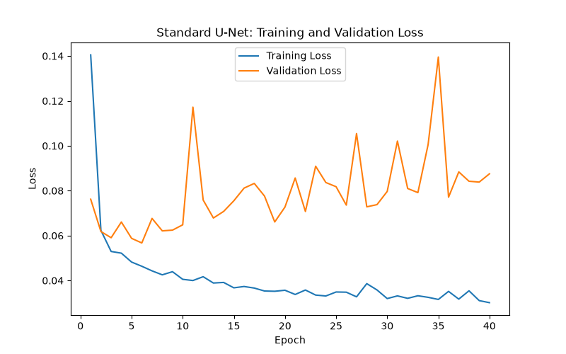
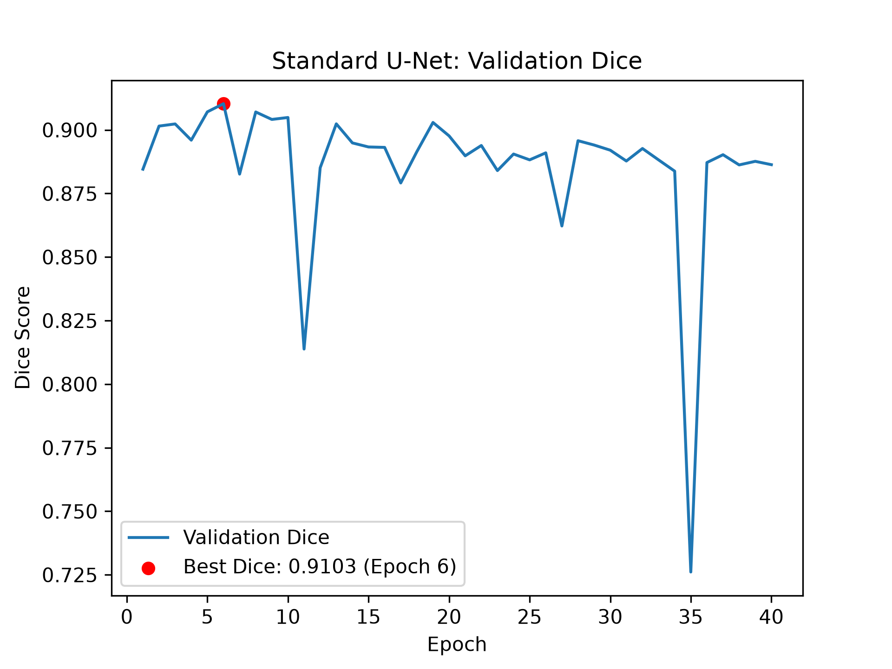
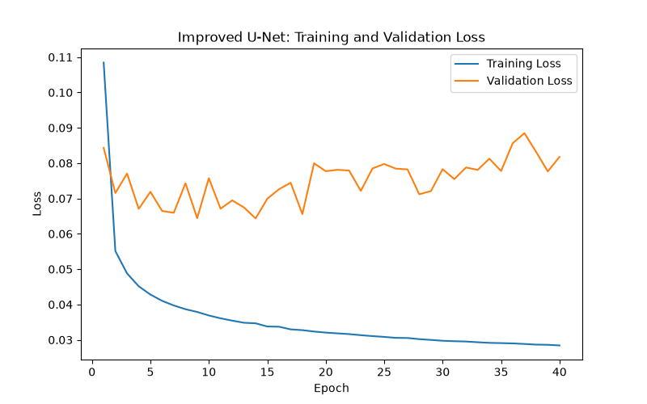
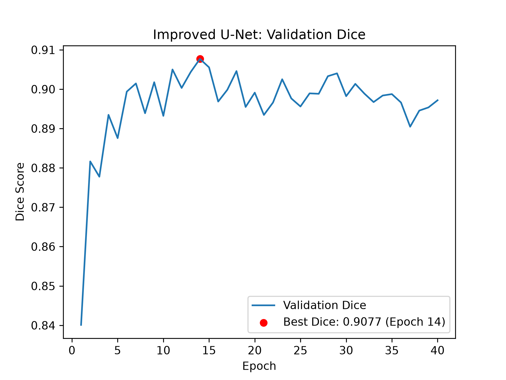
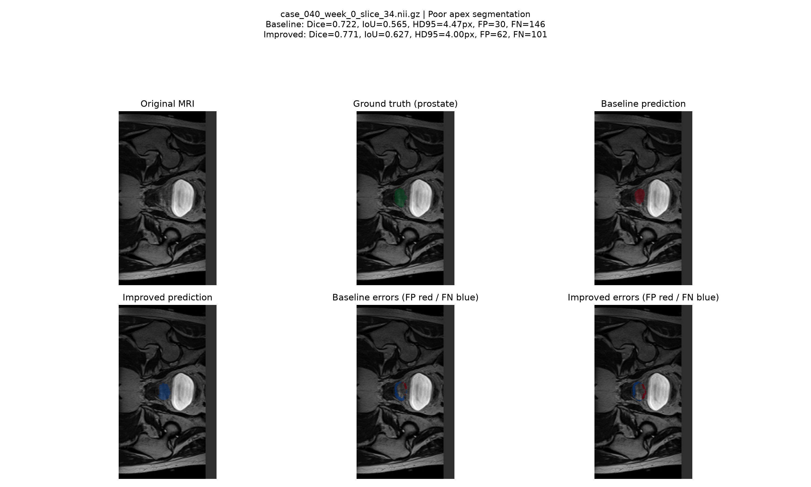
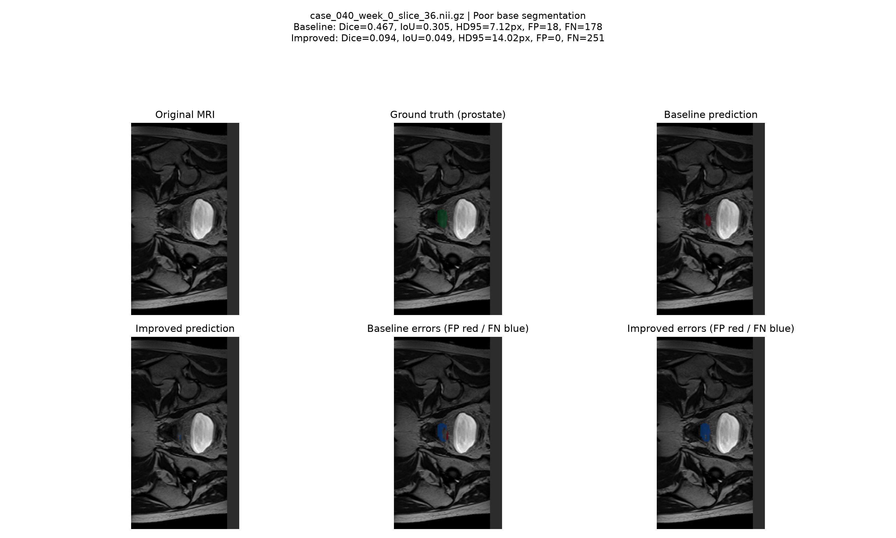
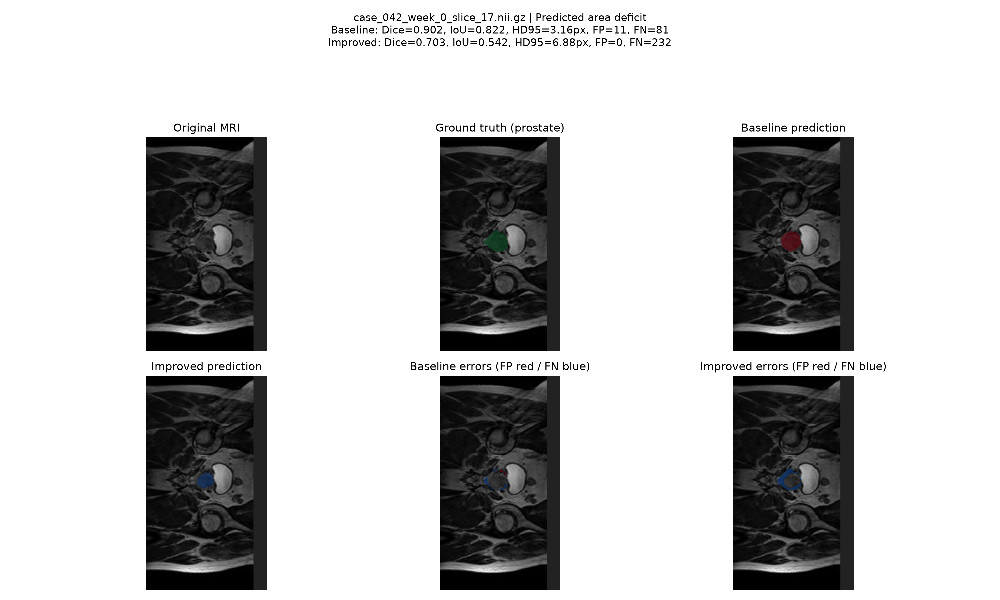
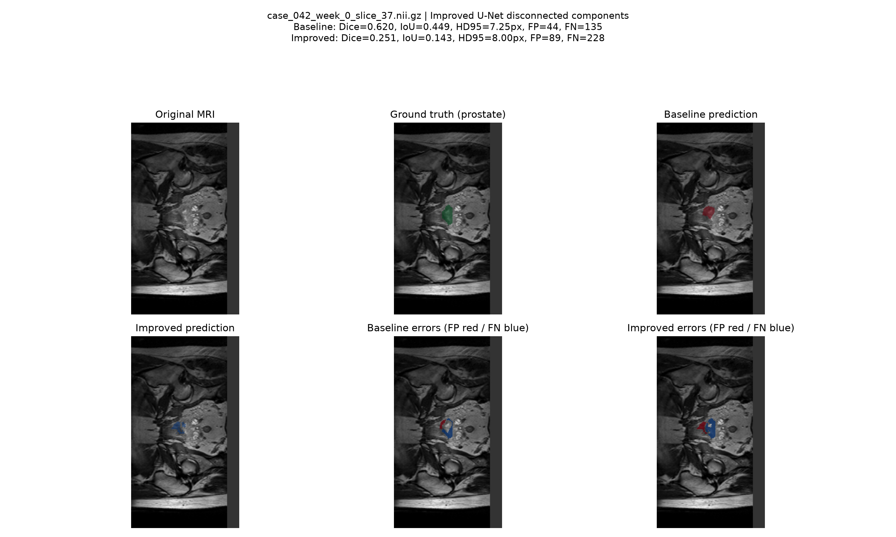
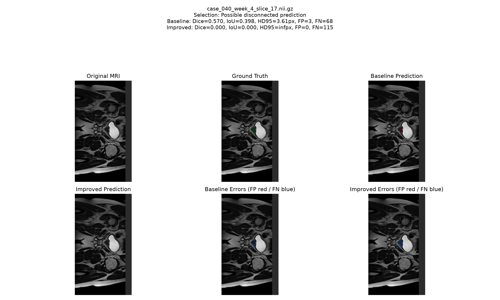

# HipMRI Prostate Segmentation

COMP3710 Pattern Recognition

**Project 2**: Segmentation: Anatomical Contouring and Radiotherapy Planning

**Selected model**: 2D Improved U-Net 

**Baseline**: Standard 2D U-Net

## Overview

This project investigates automated anatomical segmentation of MRI images using deep learning. Accurate segmentation is important for medical image analysis, as manually identifying anatomical boundaries can be time-consuming and subject to variability. The project compares a standard 2D U-Net with an improved 2D U-Net to investigate whether architectural modifications can improve segmentation accuracy and boundary precision, particularly for prostate segmentation. Both models are evaluated using identical dataset splits to assess predictive performance, computational efficiency and failure modes.

## Data and preprocessing

The project used the HipMRI dataset (Dowling et al., 2015), consisting of 2D MRI slices of the male pelvis and their corresponding segmentation masks. The dataset was provided in NIfTI format (.nii.gz) through the `keras_slices_data` directory. Each segmentation mask contains integer labels representing six classes, including the background and five anatomical structures relevant to prostate radiotherapy planning.

Examination of the provided segmentation masks revealed stored label values ranging from 0 to 5. Based on the classes reported by Dai et al. (2022), the corresponding labels were interpreted as background (0), body (1), bone (2), bladder (3), rectum (4) and prostate (5). This mapping was interpreted using segmentation overlays and further consultation with an MRI specialist.

### Dataset exploration and verification

Before model training, the dataset was investigated to understand its structure, label distribution and suitability for segmentation. This included examining MRI dimensions, intensity ranges, image–mask pairing, spatial alignment and patient overlap. Visualisations of the anatomical labels were also examined to verify the interpretation of the segmentation classes.

The data loader pairs images and masks using the patient, week and slice identifiers in their filenames. It checks that image and mask dimensions match and compares their NIfTI affine matrices. The dataset verification also checks that patient identifiers do not occur across different splits.

The HipMRI dataset was provided with predefined training, validation and test partitions, which were used rather than creating new splits. Patient-level separation was verified to ensure that MRI slices from the same patient did not appear across different partitions, reducing the risk of data leakage.

The dataset split is below.

| Split | MRI Slices | Segmentation Masks | Unique Patients |
|---|---:|---:|---:|
| Training | 11,460 | 11,460 | 31 |
| Validation | 660 | 660 | 4 |
| Testing | 540 | 540 | 3 |
| **Total** | **12,660** | **12,660** | **38** |


Although the test set contains 540 MRI slices, these are from only three patients, which limits how confidently the results can be generalised to a wider patient population.

### Class distribution

Class imbalance was identified as an important factor to consider because anatomical structures occupy different proportions of the MRI images. Dai et al. (2022) similarly reported substantial class imbalance in the pelvic MRI dataset, with approximately 270 times more background voxels than prostate voxels. This is  relevant because the prostate is the primary structure of interest, and its relatively small size can make accurate segmentation more challenging.

The class distribution across the dataset was:

| Class | Pixel Count | Percentage |
|---|---:|---:|
| Class 0 | 111,591,713 | 26.41% |
| Class 1 | 253,682,431 | 60.05% |
| Class 2 | 46,951,538 | 11.11% |
| Class 3 | 7,296,009 | 1.73% |
| Class 4 | 1,340,454 | 0.32% |
| Class 5 | 1,599,295 | 0.38% |

The dataset shows a large class imbalance, with Class 1 (body) accounting for 60.05% of all pixels, while the prostate (Class 5) represents only 0.38%. This imbalance may make accurate prostate segmentation more challenging because the prostate contributes less to the training objective compared with larger anatomical structures. Therefore, prostate-specific Dice and IoU scores are reported alongside overall segmentation performance to assess how effectively each model segments prostate.

### Preprocessing and Augmentation

- **Intensity normalisation:** Each MRI slice is standardised using its mean and standard deviation for consistent intensity scaling.
- **Image padding:** MRI slices and their corresponding masks are padded to 256 × 144 pixels to maintain spatial alignment.
- **Optional one-hot encoding:** The dataset loader supports converting segmentation masks into six one-hot channels. Integer class labels are used during training with multiclass cross-entropy loss.
- **Training augmentation:** Random rotations, translations and intensity scaling are applied during training. Spatial transformations use bilinear interpolation for MRI images and nearest-neighbour interpolation for masks. Augmentation is disabled for validation and testing.

Data augmentation was introduced after initial training showed signs of overfitting. It helped reduce overfitting to some extent by increasing the variability of the training data. However, both models continued to show signs of overfitting, suggesting that augmentation improved generalisation but did not completely resolve the issue.

## MODELS

### Standard 2D U-Net

The baseline model follows the standard U-Net architecture proposed by Ronneberger et al. (2015). Ito Aramendia (2024) provided further guidance on the model architecture and implementation, while Milesial’s (2021) PyTorch implementation was used as a reference when developing the model components.


The encoder consists of five stages, increasing the number of feature channels from 64 to 1024. Each stage applies two 3×3 convolutions followed by ReLU activation, with 2×2 max pooling used between stages.

The decoder has four stages using transposed convolutions for upsampling, reducing the number of feature channels from 1024 to 64. Features from matching encoder stages are concatenated with decoder features through skip connections, followed by double-convolution blocks. A final 1 × 1 convolution maps 64 features to six classes.

The implementation makes two main adaptations to the original U-Net architecture by Ronneberger et al. (2015):

- **Padding:** The 3×3 convolutions use one-pixel padding to preserve spatial dimensions, avoiding the cropping required by the original U-Net's unpadded convolutions.

- **Input and output channels:** The network accepts a single-channel MRI slice and produces six output channels, corresponding to the background and five anatomical segmentation classes.

These adaptations allow the standard U-Net architecture to be applied to the HipMRI dataset while retaining its original encoder–decoder structure.


### Improved 2D U-Net

The improved model is adapted from the modified U-Net architecture proposed by Isensee et al. (2018), originally developed for 3D brain tumour segmentation. The architecture has been adapted to use 2D convolutions instead. The model was inspired by the BraTS2017 architecture code (Isensee, 2018).


The encoder consists of five stages, increasing the number of feature channels from 8 to 128. Unlike the baseline U-Net, which uses max pooling, the improved model uses stride-2 convolutions for downsampling. Residual context blocks incorporate instance normalisation, LeakyReLU activations (negative slope 0.01) and dropout (p = 0.3).

The decoder consists of four upsampling stages, progressively reducing the number of feature channels from 128 to 8. It uses nearest-neighbour upsampling followed by convolution instead of transposed convolutions. Skip connections concatenate corresponding encoder features with the upsampled decoder features, which are then refined using localisation blocks.

The model also includes two intermediate segmentation prediction heads. Their outputs are upsampled and combined with the final segmentation logits. A final 1×1 convolution produces six output channels corresponding to the six segmentation classes.

The implementation makes several adaptations from Isensee et al. (2018):

- **2D adaptation:** Uses 2D convolutions to process individual MRI slices rather than 3D convolutions for volumetric segmentation.

- **Feature channels:** Uses 8–128 channels to reduce model size and computational requirements.

- **Input and output channels:** Accepts single-channel MRI slices and produces six segmentation output channels.

## Training procedure
Rather than reproducing the original training configurations of each architecture, a consistent training procedure was used for fair comparison. Both the baseline 2D U-Net and improved 2D U-Net were trained on the HipMRI dataset, using identical training and validation splits. Both models train using the Adam optimiser with an initial learning rate of 0.001, cross-entropy loss and a batch size of 4. 

Training was conducted for 40 epochs on an NVIDIA A100 GPU using Rangpur, with the training and validation losses monitored after each epoch to assess model convergence and potential overfitting. The model checkpoint achieving the highest validation Dice similarity coefficient (DSC) was saved for evaluation. 

By maintaining consistent dataset splits, loss function and training hyperparameters, the experiment aims to evaluate the effect of the architectural differences on segmentation performance.

### Training results

| Measure | Baseline U-Net | Improved U-Net |
|---|---:|---:|
| Best epoch | 6 | 14 |
| Best validation foreground Dice | 0.9103 | 0.9077 |
| Training time | 108.65 min | 78.03 min |
| Parameters | 31,030,918 | 796,026 |
| Peak training VRAM | 1.074 GB | 0.225 GB |

Both runs were below the project's proposed 8-hour training and 12 GB GPU-memory limits. The Improved U-Net used approximately 39 times fewer parameters.

**Standard U-Net**





**Improved U-Net**





Both models showed decreasing training losses throughout the 40 epochs, indicating they continued learning on the training data. However, validation losses fluctuated and generally increased during later epochs, suggesting potential overfitting. These fluctuations were more pronounced in the Standard U-Net, particularly in its validation loss and Dice scores.

The Standard U-Net achieved a slightly higher peak validation Dice (0.9103) at epoch 6 compared with the Improved U-Net (0.9077) at epoch 14. While the Standard U-Net maintained relatively consistent validation Dice scores overall, it experienced several sharp drops. In contrast, the Improved U-Net showed a more gradual improvement during the early epochs, followed by relatively stable validation Dice scores with smaller fluctuations.

For both models, the checkpoint achieving the highest validation Dice was selected for final evaluation.

## Evaluation Procedure
Segmentation accuracy was assessed using the DSC and Intersection over Union (IoU) for each of the segmentation classes. Mean foreground Dice and IoU scores were also calculated.

Additional analysis focused on the prostate class, measuring per-slice Dice, IoU and 95th percentile Hausdorff distance (HD95) to assess segmentation overlap and boundary accuracy. To investigate regional performance, prostate-containing slices were divided into three regions representing the apex, mid-gland and base. 

Segmentation failures were further investigated by identifying disconnected prediction components and generating visual comparisons of MRI images, ground-truth masks and model predictions, including false-positive and false-negative overlays.

Inference time, peak GPU memory usage and model parameter counts were examined to compare the computational efficiency of both models.

## Results

**Per-class segmentation performance on the held-out HipMRI test set.**

| Class | Baseline Dice | Improved Dice | Baseline IoU | Improved IoU |
|---|---:|---:|---:|---:|
| 0 | 0.9978 | 0.9981 | 0.9956 | 0.9962 |
| 1 | 0.9856 | 0.9845 | 0.9716 | 0.9695 |
| 2 | 0.9415 | 0.9377 | 0.8895 | 0.8827 |
| 3 | 0.9663 | 0.9620 | 0.9347 | 0.9269 |
| 4 | 0.8431 | 0.8472 | 0.7287 | 0.7349 |
| **5** | **0.8563** |**0.8428** | **0.7487** | **0.7282** |

**Overall segmentation performance on the held-out HipMRI test set.**

| Measure | Baseline U-Net | Improved U-Net |
|---|---:|---:|
| Mean foreground Dice (classes 1–5) | 0.9186 | 0.9148 |
| Mean foreground IoU | 0.8547 | 0.8485 |
| **Prostate Dice** | **0.8563** | **0.8428**|
| Prostate IoU | 0.7487 | 0.7282 |
| Mean finite prostate HD95 (pixels) | 3.23 | 3.56 |
| Undefined prostate HD95 cases | 18 | 35 |
| Test loss | 0.0437 | 0.0472 |
| Inference time per image | 9.25 ms | 1.74 ms |
| Peak inference VRAM | 0.421 GB | 0.062 GB |

The baseline U-Net achieved slightly higher overall segmentation performance, with a mean foreground Dice of 0.9186 and IoU of 0.8547, compared with 0.9148 and 0.8485 for the Improved U-Net. For the prostate class, the baseline achieved a Dice score of 0.8563 and IoU of 0.7487, compared with 0.8428 and 0.7282 for the Improved U-Net. Both models exceeded the project's target prostate Dice of 0.75.

The baseline achieved higher Dice and IoU scores for most foreground classes, while the Improved U-Net performed slightly better on Class 4. The baseline also achieved a lower mean finite prostate HD95, 3.23 pixels compared with 3.56 pixels, indicating better boundary agreement among cases where HD95 was defined. However, the Improved U-Net demonstrated greater computational efficiency, achieving an average inference time of 1.74 ms per image compared with 9.25 ms for the baseline, while also using less GPU memory.

### Regional prostate analysis
To examine where segmentation is less reliable, the prostate was divided into approximate apex, mid-gland and base regions using thirds of its superior–inferior extent, identified from the ground-truth prostate masks.

Anatomical orientation was verified using the original 3D HipMRI volumes and NiBabel. A Python verification script compared extracted 2D slices against their corresponding 3D volumes, confirming that the slices were coronal, with increasing column indices representing the superior direction. The verification was documented and repeated across 10 patient/week scans, with all 10 producing exact pixel matches.

Therefore, lower column indices were classified as apex, middle indices as mid-gland and higher indices as base. These regions are approximate rather than exact anatomical boundaries, so the findings remain exploratory. The verification and analysis process was assisted by OpenAI (2026).

**Regional prostate segmentation performance on the held-out HipMRI test set.**

| Region | Baseline Pooled Dice | Improved Pooled Dice |
|---|---:|---:|
| Apex | 0.8420 | 0.8002 |
| Mid-gland | 0.9102 | 0.8863 |
| Base | 0.8401 | 0.8412 |

Both models achieved their highest regional Dice scores in the mid-gland, with the baseline U-Net scoring 0.9102 and the Improved U-Net scoring 0.8863. Performance was lower towards the apex and base regions, suggesting that segmentation is less reliable at the prostate's anatomical ends.

The baseline U-Net outperformed the Improved U-Net at the apex and mid-gland, while the improved U-Net performed marginally better at the base, although the difference was negligible.

These findings suggest that the Improved U-Net did not consistently improve regional prostate segmentation. The lower Dice scores at the apex and base highlight potential difficulties in segmenting these regions, supporting the need for careful review of predictions near anatomical boundaries.


### Failure case analysis

The following five cases were selected from the held-out HipMRI test set to investigate prostate boundary errors, under-contouring, disconnected predictions and differences between the baseline and Improved U-Net. Each case was evaluated using Dice, IoU, HD95, false-positive and false-negative measurements, alongside visual comparisons of the MRI, ground truth, predictions and error overlays.

**Approximate Apex Segmentation — case_040_week_0_slice_34**


The Improved U-Net achieved a higher Dice score of 0.771 compared with 0.722 for the baseline, indicating better overlap with the ground-truth prostate region. It also achieved a lower HD95 (4.00 vs 4.47 pixels) and fewer false negatives (101 vs 146), suggesting that it captured more prostate tissue with slightly better boundary agreement. However, it also produced more false positives (62 vs 30), indicating greater over-segmentation. The error overlays show that both models missed parts of the prostate and incorrectly included some surrounding tissue. This case demonstrates the trade-off between reducing under-segmentation and introducing additional false positives.

**Approximate Base Segmentation — case_040_week_0_slice_36**


Both models struggled to segment the prostate accurately, with the baseline achieving a Dice score of 0.467 compared with only 0.094 for the Improved U-Net. The Improved U-Net also showed substantially greater boundary disagreement, with an HD95 of 14.02 pixels compared with 7.12 pixels for the baseline. The error overlays reveal that both models missed substantial portions of the prostate, particularly the Improved U-Net, which produced 251 false negatives compared with 178 for the baseline. Although the Improved U-Net produced no false positives, its prediction was extremely small and missed nearly the entire ground-truth prostate region. This demonstrates that fewer false positives do not necessarily indicate better segmentation accuracy when substantial under-segmentation occurs. Overall, this case highlights the difficulty of accurately segmenting the prostate near its estimated base and demonstrates that the Improved U-Net can produce significantly less reliable contours in challenging anatomical regions.


**Under-Contouring — case_042_week_0_slice_17**


The baseline achieved a Dice score of 0.902, substantially outperforming the Improved U-Net's 0.703. The Improved U-Net produced 232 false negatives compared with 81 for the baseline, indicating that it missed considerably more prostate tissue. The error overlays show that both models missed a similar region along the prostate boundary, although the Improved U-Net's missed area was substantially larger. While the Improved U-Net produced no false positives compared with 11 for the baseline, this was accompanied by greater under-segmentation. Its HD95 was also higher (6.88 vs 3.16 pixels), indicating greater boundary disagreement. This case highlights how both models can struggle with the same prostate boundary, with the Improved U-Net producing a more incomplete contour.

**Disconnected Segmentation — case_042_week_0_slice_37**


The Improved U-Net produced four disconnected prostate components, while the baseline produced one component. Its Dice score was also considerably lower (0.251 vs 0.620), while HD95 increased from 7.25 to 8 pixels, suggesting slightly worse boundary agreement. The error overlays show that both models missed parts of the prostate and incorrectly included surrounding tissue. However, the Improved U-Net produced more false positives (89 vs 44) and false negatives (228 vs 135), indicating greater over-segmentation and under-segmentation. The presence of multiple disconnected regions also suggests that the Improved U-Net struggled to maintain a continuous prostate contour. This case demonstrates that segmentation errors can involve both inaccurate boundaries and fragmented predictions, which may require additional manual correction.

**Complete Prostate Miss — case_040_week_4_slice_17**


The Improved U-Net failed to identify the prostate in this MRI slice, achieving a Dice score of 0 and producing 115 false negatives with no false positives. The error overlay confirms that the entire ground-truth prostate region was missed. An undefined HD95 is reported as no predicted prostate boundary was available for comparison. In contrast, the baseline achieved a Dice score of 0.570, identifying some prostate tissue but still missing 68 pixels. Although neither model produced an accurate contour, the Improved U-Net's complete failure demonstrates a severe segmentation error. 

## Engineering Interpretation and Recommendation

The Improved U-Net reduced model size, training time, inference time and GPU memory usage compared with the baseline U-Net. However, these efficiency improvements did not translate into better overall prostate segmentation accuracy or boundary precision. This is evident in the baseline achieving a higher prostate Dice (0.8563 versus 0.8428) and lower mean finite HD95 (3.23 versus 3.56 pixels), making it the preferable model when segmentation quality is prioritised.

The failure-case analysis further demonstrated that satisfactory overall Dice scores do not guarantee reliable predictions for individual MRI images. Both models experienced difficulties with challenging prostate regions, including inaccurate boundaries, under-contouring and disconnected predictions. The Improved U-Net performed better in one selected apex-related case but exhibited more severe failures in several others, including a complete prostate miss. These findings indicate that its computational advantages come with a trade-off in segmentation reliability.

For a practical radiotherapy contouring assistant, the baseline U-Net is therefore recommended under the tested conditions. The Improved U-Net may be considered when computational resources are severely constrained, but its reduced segmentation accuracy must be considered. Neither model has been sufficiently validated for autonomous clinical use, and predictions involving uncertain boundaries, missing prostate tissue or disconnected regions would require specialist review and correction.

Future work could investigate uncertainty estimation, segmentation post-processing, broader patient-level validation and 3D architectures that incorporate inter-slice continuity to improve anatomical consistency.

## Limitations

- **Limited test population:** Although the test set contains 540 MRI slices, these originate from only three patients, limiting how well the results may generalise to other patients.

- **Different model sizes:** The baseline U-Net has approximately 39 times more parameters than the Improved U-Net, making it difficult to determine which architectural differences contributed to the performance gap.

- **Approximate anatomical regions:** The apex, mid-gland and base regions were estimated using the prostate's anatomical orientation rather than exact anatomical boundaries. Therefore, the regional findings should be interpreted as exploratory.

- **Undefined HD95 values:** Cases where HD95 could not be calculated were excluded from the reported finite mean. This means the average HD95 does not fully represent severe failures, such as when a model completely misses the prostate.

- **Lack of 3D spatial information:** Both models process MRI slices independently without considering neighbouring slices. This limits their ability to capture three-dimensional anatomical information and may contribute to inconsistent segmentation between slices.

## Reproducibility

The experiments were conducted using Python and PyTorch on an NVIDIA A100 GPU through the UQ Rangpur computing environment. A prototype was also tested on an NVIDIA RTX 3060. Both models were trained and evaluated using the same patient-level dataset splits. Random seed 42 was used during training to improve reproducibility and reduce variation caused by random weight initialisation, data shuffling and augmentation. Both models used the same seed to support a consistent experimental comparison. 

### 1. Environment Setup

The project uses Python and PyTorch. A Python virtual environment (`.venv`) is recommended to isolate project dependencies and avoid conflicts with other Python installations.

**Create a virtual environment:**

```bash
python -m venv .venv
```

**Activate the virtual environment:**

Windows (PowerShell):

```powershell
.\.venv\Scripts\Activate.ps1
```

Linux (including Rangpur):

```bash
source .venv/bin/activate
```

**Install the required dependencies:**

```bash
python -m pip install -r requirements.txt
```

The required Python packages and their versions are listed in `requirements.txt`.

### 2. Dataset Setup

The HipMRI dataset was provided through the course and is not included in this repository.

The dataset should contain the following directory structure:

```text
keras_slices_data/
├── keras_slices_train/
├── seg_train/
├── keras_slices_validate/
├── seg_validate/
├── keras_slices_test/
└── seg_test/
```

Update the dataset path in `dataset.py` to match the local location of `keras_slices_data`.

### 3. Model Training

**Train the standard 2D U-Net:**

```bash
python train.py
```

**Train the Improved 2D U-Net:**

```bash
python train_improved.py
```

The checkpoints with the highest validation Dice scores are saved as:

```text
checkpoints/
├── unet_baseline_best.pth
└── unet_improved_best.pth
```

### 4. Model Evaluation

Evaluate both trained models on the held-out test set:

```bash
python evaluate.py
```

### 5. Regional and Failure-Case Analysis

**Generate the regional prostate analysis:**

```bash
python regional_analysis.py
```

**Generate segmentation comparisons and failure-case visualisations:**

```bash
python predict.py
python generate_selected_failures.py
```

### 6. Reproducing the Reported Results

The reported results were obtained using the best validation checkpoints for both models.

Training results may vary depending on the hardware, software versions and random initialisation.

The original MRI dataset and trained model checkpoints are not included in the repository.

## Feasibility Review

1. User Need, Scope & Acceptance Criteria
The intended users are radiotherapy imaging specialists who outline the prostate and nearby organs on MRI scans. This project proposes a 2D segmentation assistant that generates anatomical contours. The engineering dilemma is whether a 2D Improved U-Net improves prostate segmentation, particularly at the base and apex, compared with a standard 2D U-Net while maintaining reasonable computational costs.
Acceptance criteria:
1.	Segmentation accuracy: Achieve a prostate DSC of at least 0.75 on the held-out test set and report per-class Dice and IoU.
2.	Regional performance: Compare prostate DSC across base, central and apex slices, after checking which slices correspond to each region.
3.	Failure analysis: Examine 3–5 boundary failure cases through MRI images, ground truth, predictions and false-positive/false-negative overlays, identifying leakage, under-contouring and disconnected artifacts. 
4.	Usability assessment: Compare segmentation errors between both models and identify cases where predicted contours still require substantial specialist correction.
5.	Computational feasibility: Train both models within the local GPU’s 12 GB VRAM capacity. Measure peak GPU memory, parameter count and inference time per 2D slice under identical evaluation conditions and assess the accuracy–cost trade-off. 
2. Model Choice & Course Concepts
The selected model is the 2D Improved U-Net using the HipMRI 2D slice dataset. A standard 2D U-Net will be used as the comparison baseline. Both models will use the same patient-separated splits and evaluation procedure.
The standard U-Net uses an encoder-decoder architecture with convolutional layers and skip connections to extract image features and reconstruct segmentation masks. The Improved U-Net replaces standard convolutional blocks with residual blocks, introducing shortcut connections that allow features to bypass convolutional layers. These connections are intended to improve gradient propagation and feature learning, potentially improving segmentation of challenging prostate boundaries, particularly at the base and apex.
The approach applies course concepts including convolutional neural networks, feature extraction, backpropagation, optimisation, segmentation loss functions and quantitative model evaluation. 
3. Preliminary Feasibility Evidence
An initial audit of the HipMRI 2D dataset identified 12,660 paired MRI slices and segmentation masks, comprising 11,460 training, 660 validation and 540 test pairs. Image dimensions were either 256 × 128 or 256 × 144, with segmentation labels ranging from 0 to 5. All pairs passed the implemented pairing and dimension. No patient overlap was detected between the dataset splits based on patient identifiers in the filenames.
Local GPU testing was conducted using an NVIDIA RTX 3060 with 12 GB VRAM. A prototype residual U-Net completed a forward pass, loss calculation, backward pass and optimiser update using synthetic inputs of shape 4 × 1 × 256 × 256. The measured training step took 0.023 seconds, with 0.282 GB peak PyTorch allocated GPU memory. These results support initial execution feasibility, however real-data training costs and segmentation accuracy remain untested.
4. Risks, Budget & Fallback
The main technical risks are class imbalance, inaccurate segmentation at the prostate base and apex, disconnected predictions and inconsistent segmentation between slices. Patient separation and image–mask alignment must be preserved throughout preprocessing.
Local training will be prioritised within the 12 GB VRAM budget, with the university Virtual GPU Lab and Rangpur A100 available if required. The next experiment will confirm anatomical label mapping, implement intensity normalisation and aligned image–mask preprocessing, and train the standard U-Net baseline while recording validation DSC, memory usage and epoch time. Validation data will guide model selection and the test set will be reserved for final evaluation.
If the Improved U-Net underperforms, preprocessing, loss functions and training settings will be investigated using validation data with the standard U-Net remaining a fallback. The final recommendation will report observed benefits, failures and computational trade-offs.

## References

Dai, W., Woo, B., Liu, S., Marques, M., Engstrom, C., Greer, P. B., Crozier, S., Dowling, J. A., & Chandra, S. S. (2022). CAN3D: Fast 3D medical image segmentation via compact context aggregation. *Medical Image Analysis, 82*, Article 102562. https://doi.org/10.1016/j.media.2022.102562

Dowling, J. A., Sun, J., Pichler, P., Rivest-Hénault, D., Ghose, S., Richardson, H., Wratten, C., Martin, J., Arm, J., Best, L., Chandra, S. S., Fripp, J., Menk, F. W., & Greer, P. B. (2015). Automatic substitute CT generation and contouring for MRI-alone external beam radiation therapy from standard MRI sequences. *International Journal of Radiation Oncology, Biology, Physics, 93*(5), 1144–1153. https://doi.org/10.1016/j.ijrobp.2015.08.045

Isensee, F. (2018). *network_architecture.py* [Source code]. GitHub. https://github.com/MIC-DKFZ/BraTS2017/blob/master/network_architecture.py

Ito Aramendia, A. (2024, February 1). *The U-Net: A complete guide*. Medium. https://medium.com/@alejandro.itoaramendia/decoding-the-u-net-a-complete-guide-810b1c6d56d8

Milesial. (2021). *unet_parts.py* [Python source code]. GitHub. https://github.com/milesial/Pytorch-UNet/blob/master/unet/unet_parts.py

OpenAI. (2026). *ChatGPT* [Large language model]. https://chatgpt.com/

Ronneberger, O., Fischer, P., & Brox, T. (2015). U-Net: Convolutional networks for biomedical image segmentation. In N. Navab, J. Hornegger, W. M. Wells, & A. F. Frangi (Eds.), *Medical image computing and computer-assisted intervention – MICCAI 2015* (Lecture Notes in Computer Science, Vol. 9351, pp. 234–241). Springer. https://doi.org/10.1007/978-3-319-24574-4_28


## Artificial Intelligence Usage Disclosure

OpenAI's ChatGPT (2026) was used throughout this project to assist with code development, debugging, experimental analysis and documentation.

AI was used in the following areas:

- **Project planning and model development:** Guidance on interpreting the project requirements. ChatGPT assisted with understanding and implementing architectural components.

- **Dataset loading and preprocessing:** Assistance with developing and reviewing `dataset.py`, including loading NIfTI MRI images and segmentation masks, matching image–mask filenames, verifying dataset splits, checking spatial alignment, normalising image intensities and applying data augmentation.

- **Model implementation and training:** Guidance on developing and debugging the baseline and Improved U-Net architectures and reviewing code for correctness and identifying potential implementation issues.

- **MRI visualisation and plotting:** Assistance with writing Python code to generate MRI visualisations, segmentation-mask overlays, anatomical label comparisons and prediction comparison figures. 

- **Model evaluation:** Assistance with developing and reviewing `evaluate.py`, including calculating DSC, IOU, HD95 and model parameter counts.

- **Regional and anatomical analysis:** Guidance on developing `regional_analysis.py`, verifying MRI anatomical orientation, dividing the prostate into approximate apex, mid-gland and base regions, calculating regional segmentation metrics and examining disconnected segmentation components.

- **Prediction and failure-case analysis:** Assistance with developing and reviewing `predict.py` and `generate_selected_failures.py` to generate model predictions, compare them with ground-truth masks, identify challenging segmentation cases and produce visualisations of false-positive and false-negative errors. ChatGPT also assisted with interpreting the failure cases.

- **Results processing and CSV generation:** Helped with calculating summary statistics and saving results to CSV files.

- **Documentation and interpretation:** Assistance with refining and writing the README and interpretting results


### Verification of AI-Assisted Work

AI-assisted code and recommendations were critically reviewed and verified. This involved examining the logic of generated code, researching unfamiliar concepts to understand their purpose and checking whether suggested implementations were appropriate for the project. Additional tests were developed and executed to verify code functionality, identify errors and confirm that the outputs were consistent with expectations.

For example, the anatomical class labels suggested during development were verified against the actual HipMRI dataset by inspecting segmentation-mask values and visualising the corresponding anatomical structures. Dataset integrity was also checked through image–mask pairing, spatial alignment verification and patient-level split checks.

Model implementations and evaluation scripts were reviewed and tested to confirm that they operated as intended. Quantitative results were obtained by executing the training and evaluation scripts on the HipMRI dataset. Generated MRI visualisations, segmentation predictions and failure-case analyses were examined against ground-truth masks to assess their validity.

AI was used to support implementation, problem-solving and analysis, while the generated suggestions were evaluated through independent research, code inspection and experimental testing. 