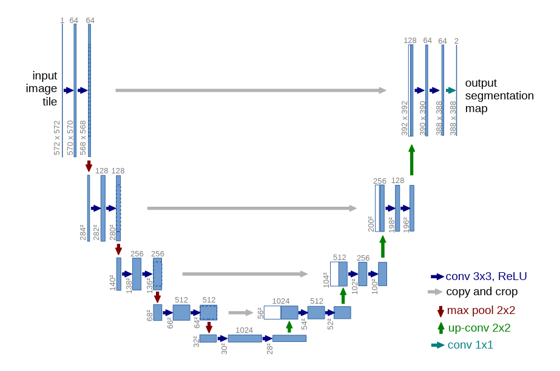
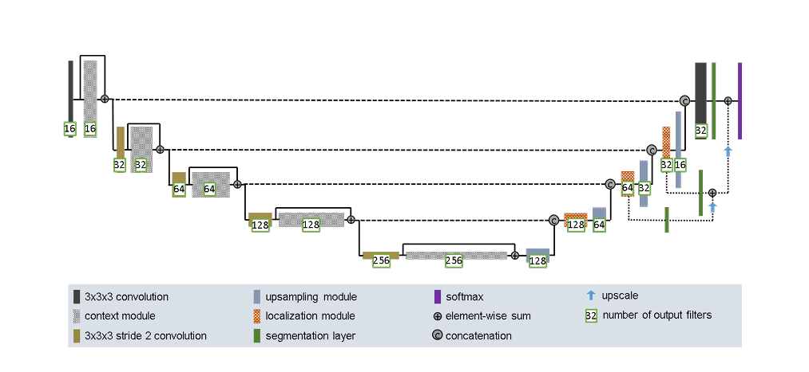

# HipMRI Prostate Segmentation

COMP3710 Pattern Recognition

Project 2: Segmentation: Anatomical Contouring and Radiotherapy Planning
Selected model: 2D Improved U-Net 
Baseline: Standard 2D U-Net

## Overview

This project investigates automated anatomical segmentation of MRI images using deep learning. Accurate segmentation is important for medical image analysis, as manually identifying anatomical boundaries can be time-consuming and subject to variability. The project compares a standard 2D U-Net with an improved 2D U-Net to investigate whether architectural modifications can improve segmentation accuracy and boundary precision, particularly for prostate segmentation. Both models are evaluated using identical dataset splits to assess predictive performance, computational efficiency and segmentation failure modes.

## Data and preprocessing

The project used the HipMRI dataset (Dowling et al., 2015), consisting of two-dimensional MRI slices of the male pelvis and their corresponding anatomical segmentation masks. The dataset was provided in NIfTI format (.nii.gz) through the `keras_slices_data` directory. Each segmentation mask contains integer labels representing six classes, including the background and five anatomical structures relevant to prostate radiotherapy planning.

Dai et al. (2022) identify six segmentation classes in the HipMRI dataset: background (1), bladder (2), body (3), bone (4), rectum (5) and prostate (6). Examination of the provided segmentation masks revealed stored label values ranging from 0 to 5, suggesting a zero-based indexing scheme. Based on the class ordering reported by Dai et al. (2022), the corresponding labels were interpreted as background (0), bladder (1), body (2), bone (3), rectum (4) and prostate (5). This interpretation was further supported by visual inspection of segmentation overlays and consultation with an MRI specialist, providing additional confidence that label 5 represents the prostate.

The data training, validation and test sets were used with a check that patient IDs do not ovrelap. Image intensity normalisation was applied during preprocessing to standardise the input values. Initial model found that the model was overfitting, to improve this augmenetation was introduced in the dataset.

### Dataset exploration and verification

Before model training, the dataset was investigated to understand its structure, label distribution and suitability for segmentation. This included examining MRI dimensions, intensity ranges, segmentation mask values and the correspondence between MRI images and their ground-truth masks. Visualisations of the anatomical labels were also examined to verify the interpretation of the segmentation classes.
The dataset loader uses the MRI filenames to pair images with their corresponding masks. Patient-level separation is checked before training to reduce leakage between splits. MRI images and segmentation masks were matched using the patient ID, week and slice number encoded in their filenames.
Patient IDs were compared across the three predefined splits to check for data leakage. No overlapping patient IDs were identified. Patient-level leakage, MRI–mask pairing, spatial alignment, image dimensions, valid pixel values, valid segmentation labels were teseted. All 12,660 MRI-mask pairs passed the dataset inspection checks.

The dataset contains segmentation masks with integer labels ranging from 0 to 5, representing six anatomical classes. The data loader supports optional one-hot encoding, which converts each pixel into a six-channel binary representation, with a value of 1 assigned to the corresponding class channel and 0 to all others. This functionality was implemented and tested during dataset verification.

However, one-hot encoding was disabled during training because both models use PyTorch's multiclass cross-entropy loss, which directly accepts integer class labels. Therefore, the original integer masks were retained during training to avoid unnecessary conversion while maintaining compatibility with the loss function.

The dataset split is below.

| Split | MRI Slices | Segmentation Masks | Unique Patients |
|---|---:|---:|---:|
| Training | 11,460 | 11,460 | 31 |
| Validation | 660 | 660 | 4 |
| Testing | 540 | 540 | 3 |
| **Total** | **12,660** | **12,660** | **38** |

Although the test set contains 540 MRI slices, these originate from only three patients, which limits how confidently the results can be generalised to a wider patient population.

Class imbalance was identified as an important consideration because anatomical structures occupy different proportions of the MRI images. Dai et al. (2022) similarly report substantial class imbalance in the pelvic MRI dataset, with approximately 270 times more background voxels than prostate voxels. This is particularly relevant because the prostate is the primary structure of interest, and its relatively small size can make accurate segmentation more challenging.

The class imbalance was assed as

| Class | Pixel Count | Percentage |
|---|---:|---:|
| Class 0 | 111,591,713 | 26.41% |
| Class 1 | 253,682,431 | 60.05% |
| Class 2 | 46,951,538 | 11.11% |
| Class 3 | 7,296,009 | 1.73% |
| Class 4 | 1,340,454 | 0.32% |
| Class 5 | 1,599,295 | 0.38% |

The dataset exhibits substantial class imbalance, with Class 1 accounting for 60.05% of all pixels, while the prostate (Class 5) represents only 0.38%. This imbalance presents a challenge for segmentation, as the models may favour more frequently occurring classes. Therefore, prostate-specific Dice and IoU scores are reported alongside overall segmentation performance to assess how effectively each model segments the target anatomy.

Both the baseline U-Net and Improved U-Net used the same dataset partitions and preprocessing pipeline to ensure a consistent experimental comparison.

## MODELS

### Standard 2D U-Net

The baseline model follows the standard U-Net architecture proposed by Ronneberger et al. (2015), as illustrated below. Additional guidance on the architecture and its implementation was obtained from Ito Aramendia (2024), while the PyTorch implementation by Milesial (2021) was used as a reference for developing the model's components.

The encoder consists of five stages, progressively increasing the number of feature channels from 64 to 1024. Each stage applies two 3×3 convolutions followed by ReLU activation, with 2×2 max pooling used between stages to reduce spatial resolution. This allows the network to capture both low-level image features, such as edges and textures, and higher-level anatomical information.

The decoder consists of four upsampling stages, progressively reducing the number of feature channels from 1024 to 64. Each stage uses a transposed convolution to increase spatial resolution. Skip connections concatenate feature maps from corresponding encoder stages with decoder features, helping recover spatial details lost during downsampling and improving the localisation of anatomical boundaries.

The implementation makes two main adaptations to the original U-Net architecture:

- **Padding:** The 3×3 convolutions use one-pixel padding to preserve spatial dimensions, avoiding the cropping required by the original U-Net's unpadded convolutions for appropriately sized inputs.
- **Input and output channels:** The network accepts a single-channel MRI slice and produces six output channels, corresponding to the background and five anatomical segmentation classes.

These adaptations allow the standard U-Net architecture to be applied to the HipMRI dataset while retaining its original encoder–decoder structure.

### Improved 2D U-Net

The improved model is adapted from the modified U-Net architecture proposed by Isensee et al. (2018), originally developed for 3D brain tumour segmentation. The architecture has been adapted to use 2D convolutions for segmentation of the HipMRI dataset. The model was inspired by the code of Isensee (2018) The architecture is shown below.

The encoder consists of five stages, progressively increasing the number of feature channels from 8 to 128. Unlike the baseline U-Net, which uses max pooling, the improved model uses stride-2 convolutions to reduce spatial resolution. Each stage incorporates residual connections, allowing features to bypass intermediate convolutional layers. The model also uses instance normalisation, LeakyReLU activation and dropout (p = 0.3) to support feature learning and regularisation.

The decoder consists of four upsampling stages, progressively reducing the number of feature channels from 128 to 8. Instead of transposed convolutions, the model uses nearest-neighbour upsampling followed by 3×3 convolutions. Skip connections concatenate features from corresponding encoder stages with the upsampled decoder features. Localisation blocks then refine the combined features using 3×3 and 1×1 convolutions.

The improved model also incorporates deep supervision, using additional segmentation prediction layers at intermediate decoder stages. These predictions are upsampled and combined with the final segmentation output through element-wise addition.

Finally, a 1×1 convolution produces six output channels corresponding to the background and five anatomical segmentation classes.

These modifications aim to improve feature learning and segmentation accuracy while retaining the encoder–decoder structure of U-Net.

The implementation makes several adaptations to the original architecture proposed by Isensee et al. (2018):

- **2D adaptation:**: The original architecture uses 3D convolutions for volumetric MRI segmentation, whereas this implementation uses 2D convolutions to process individual MRI slices.

- **Feature channels:** The number of feature channels is reduced to 8–128 to lower memory usage and computational requirements.

- **Input and output channels:** The model accepts single-channel MRI slices instead of multi-modal 3D MRI inputs and produces six output channels corresponding to the background and five anatomical segmentation classes.

## Training procedure
Both the baseline 2D U-Net and improved 2D U-Net were trained using the HipMRI dataset, with the same training and validation splits to ensure a consistent comparison. Both models used the Adam optimiser with an initial learning rate of 0.001, cross-entropy loss and a batch size of 4. Training was conducted for 40 epochs on an NVIDIA A100 GPU using Rangpur, with the training and validation losses monitored after each epoch to assess model convergence and potential overfitting. The model checkpoint achieving the highest validation Dice similarity coefficient (DSC) was saved for subsequent evaluation. By keeping the dataset splits, loss function and training hyperparameters consistent, the experiment aims to evaluate the effect of the architectural differences on segmentation performance.

### Training results

| Measure | Baseline U-Net | Improved U-Net |
|---|---:|---:|
| Best epoch | 6 | 14 |
| Best validation foreground Dice | 0.9103 | 0.9077 |
| Training time | 108.65 min | 78.03 min |
| Parameters | 31,030,918 | 796,026 |
| Peak training VRAM | 1.074 GB | 0.225 GB |

Both runs were below the project's proposed 8-hour training and 12 GB GPU-memory limits. The Improved U-Net used approximately 39 times fewer parameters.

## Evaluation Procedure
Both models were evaluated using their best saved checkpoints on the held-out HipMRI test set. Segmentation accuracy was assessed using the Dice similarity coefficient (DSC) and Intersection over Union (IoU) for each of the six segmentation classes, alongside the mean foreground Dice and IoU scores, excluding the background class.

Additional analysis focused on the target prostate class, measuring per-slice Dice, IoU and 95th percentile Hausdorff distance (HD95) to assess segmentation overlap and boundary accuracy. To investigate regional performance, slices containing the target structure were grouped into three regions representing the two ends and central portion of the prostate. Inter-slice consistency was also examined by measuring changes in predicted segmentation area between adjacent slices.

Segmentation failures were further investigated by identifying additional disconnected components and generating visual comparisons of MRI images, ground-truth masks and model predictions, including false-positive and false-negative overlays. Finally, inference time, peak GPU memory usage and model parameter counts were examined to compare computational efficiency.
